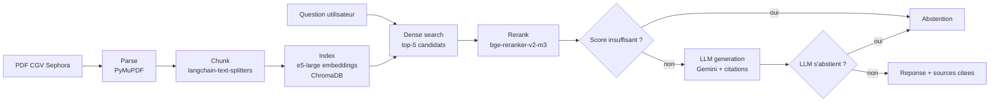

# Customer Policy RAG


Système RAG (Retrieval-Augmented Generation) construit de bout en bout sur les conditions générales de vente (CGV) de Sephora France, avec citation des sources et abstention quand la réponse n'est pas dans le corpus.

Projet personnel réalisé pour maîtriser chaque brique d'un pipeline RAG en production : parsing, chunking, indexation vectorielle, retrieval dense + reranking, génération avec citations, évaluation quantitative.

## Architecture



Deux niveaux d'abstention : un seuil de score avant même d'appeler le LLM (filtre les cas où aucun passage pertinent n'existe), et une abstention décidée par le LLM lui-même via une sortie structurée (gère les cas où les passages existent mais ne répondent pas vraiment à la question).

## Démo


## Setup

Prérequis : Python 3.14, [uv](https://docs.astral.sh/uv/), une clé API Gemini.

```bash
git clone https://github.com/fatima-zahra-hannou/customer-policy-rag.git
cd customer-policy-rag
uv sync

echo "GEMINI_API_KEY=ta_clé" > .env

# Construire l'index (une seule fois, ou après modification du PDF source)
uv run python -m rag.parse
uv run python -m rag.chunk
uv run python -m rag.index
```

Lancer l'API :

```bash
uv run uvicorn rag.api:app --reload
# puis http://localhost:8000/docs pour tester interactivement
```

Lancer l'interface Streamlit :

```bash
uv run streamlit run app.py
```

Lancer les tests unitaires :

```bash
uv run pytest tests/ -v
```

## Résultats mesurés

### Corpus

| Métrique | Valeur |
|---|---|
| Pages | 19 |
| Chunks | 156 |

### Retrieval

Mesuré sur un golden set de questions annotées avec la page et le passage attendus (k = 5).

| Configuration | Recall@5 | MRR@5 |
|---|---|---|
| Dense search seul (e5-large) | 60 % | 0.471 |
| Dense search + reranking (version retenue) | 80 % | 0.574 |

Les 4 questions restant en échec après reranking relèvent d'un écart de vocabulaire entre la question posée et les termes du document (pas d'un bug de pipeline).

### Génération (sur 24 questions : 20 in-corpus, 4 hors-corpus)

Modèle retenu : `gemini-3.1-flash-lite` (un seul modèle du début à la fin de la mesure, condition nécessaire pour que les résultats soient comparables).

| Catégorie | Résultat |
|---|---|
| Citation correcte | 16/20 (80 %) |
| Mauvaise citation | 4/20 (20 %) |
| Refus à tort (question in-corpus) | 0/20 |
| Abstention correcte (question hors-corpus) | 3/4 |

## Décisions techniques et compromis

- **Embedding CPU-only (`intfloat/multilingual-e5-large`) et reranking (`BAAI/bge-reranker-v2-m3`) chargés en mémoire une seule fois au niveau module**, pas à chaque appel : coûteux à charger, bon marché à réutiliser.
- **Seuil d'abstention pré-LLM fixé à 0** après avoir constaté qu'un seuil arbitraire (0.1, jamais validé empiriquement) bloquait des questions in-corpus valides. L'abstention finale repose sur le jugement du LLM via sortie structurée (`abstained: bool`), pas sur un seuil de score non calibré.
- **Pas de framework comme LangChain pour le cœur du pipeline** (génération, retrieval) : appels directs au SDK `google-genai`. Choix délibéré pour garder un contrôle total et une compréhension complète de chaque étape, objectif premier de ce projet. `langchain-text-splitters` est conservé uniquement pour le chunking, où il apporte une vraie valeur sans réécrire un découpeur de texte récursif à la main.
- **Device CPU forcé explicitement** pour les modèles d'embedding et de reranking, pour contourner une incompatibilité GPU locale (CUDA non supporté par le matériel de développement).

## Limitations connues

- **Contextual retrieval (technique Anthropic) testée puis abandonnée** : ajouter un résumé de contexte par chunk généré par LLM a fait régresser le recall (80 % → 75 %) et le MRR (0.574 → 0.524). Revert effectué et documenté par deux commits séparés (mesure, puis retour en arrière), plutôt que silencieusement supprimé.
- **Mesure de faithfulness (RAGAS) abandonnée** : conflits de dépendances irrésolvables entre `langchain-text-splitters` et l'écosystème `langchain-google-vertexai` sur lequel repose RAGAS, puis blocages de crédits sur les fournisseurs LLM testés comme juge indépendant (OpenAI, Mistral). Reste un axe d'amélioration futur, avec un environnement Python isolé dédié à l'évaluation comme piste la plus propre.

## Stack technique

PyMuPDF, langchain-text-splitters, ChromaDB, sentence-transformers (e5-large, bge-reranker-v2-m3), google-genai (Gemini), FastAPI, Streamlit, pytest, Docker, uv.
