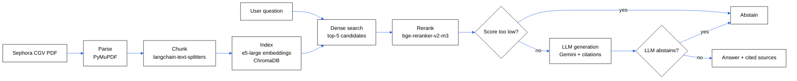

# Customer Policy RAG


End-to-end RAG (Retrieval-Augmented Generation) system built on Sephora France's terms of sale (CGV), answering customer questions with cited sources and abstaining when the answer is not in the corpus.

Personal project built to master every component of a production RAG pipeline: parsing, chunking, vector indexing, dense retrieval with reranking, generation with citations, and quantitative evaluation.

## Architecture



Two-level abstention: a pre-LLM score threshold (filters cases where no relevant passage exists), and an abstention decided by the LLM itself through structured output (handles cases where passages exist but do not actually answer the question).

## Demo


## Setup

Requirements: Python 3.14, [uv](https://docs.astral.sh/uv/), a Gemini API key.

```bash
git clone https://github.com/fatima-zahra-hannou/customer-policy-rag.git
cd customer-policy-rag
uv sync

echo "GEMINI_API_KEY=your_key" > .env

# Build the index (once, or after changing the source PDF)
uv run python -m rag.parse
uv run python -m rag.chunk
uv run python -m rag.index
```

Run the API:

```bash
uv run uvicorn rag.api:app --reload
# then http://localhost:8000/docs for interactive testing
```

Run the Streamlit interface:

```bash
uv run streamlit run app.py
```

Run the unit tests:

```bash
uv run pytest tests/ -v
```

## Measured results

### Corpus

| Metric | Value |
|---|---|
| Pages | 19 |
| Chunks | 156 |

### Retrieval

Measured on a golden set of questions annotated with the expected page and passage (k = 5).

| Configuration | Recall@5 | MRR@5 |
|---|---|---|
| Dense search only (e5-large) | 60% | 0.471 |
| Dense search + reranking (version used) | 80% | 0.574 |

The 4 remaining failures after reranking stem from a vocabulary mismatch between the question and the document's wording, not a pipeline bug.

### Generation (24 questions: 20 in-corpus, 4 out-of-corpus)

Model used: `gemini-3.1-flash-lite` (single model throughout the measurement, a necessary condition for the results to be comparable).

| Category | Result |
|---|---|
| Correct citation | 16/20 (80%) |
| Wrong citation | 4/20 (20%) |
| Wrongly refused (in-corpus question) | 0/20 |
| Correctly abstained (out-of-corpus question) | 3/4 |

## Technical decisions

- The embedding and reranking models are loaded once at startup, not on every question, to stay fast
- The system refuses to answer when the documents do not contain the requested information: the language model itself detects this case, rather than a fixed rule based on a score
- No framework like LangChain for the core steps (retrieval, generation): direct calls to the AI SDKs, to keep full control over what the system does
- Computation runs on CPU (no GPU), due to a hardware constraint on the development machine

## Known limitations

- A context-enrichment technique was tested to improve retrieval, but it lowered result quality: it was removed after measurement
- An automated faithfulness measurement was attempted but abandoned due to dependency conflicts between libraries; remains a future improvement

## Tech stack

PyMuPDF, langchain-text-splitters, ChromaDB, sentence-transformers (e5-large, bge-reranker-v2-m3), google-genai (Gemini), FastAPI, Streamlit, pytest, Docker, uv.
